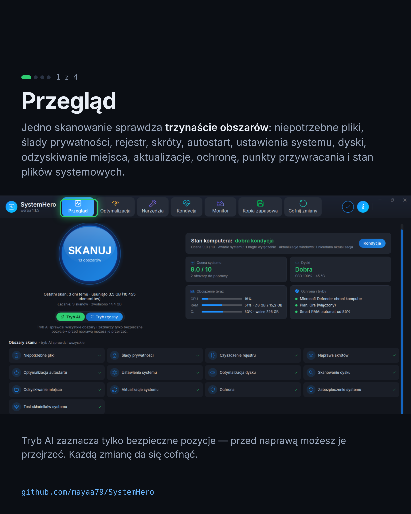
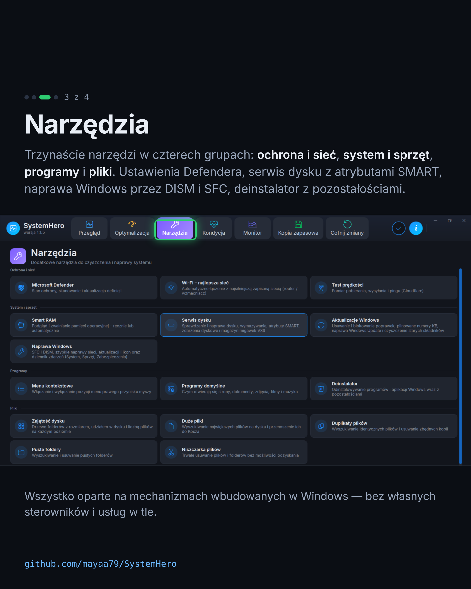
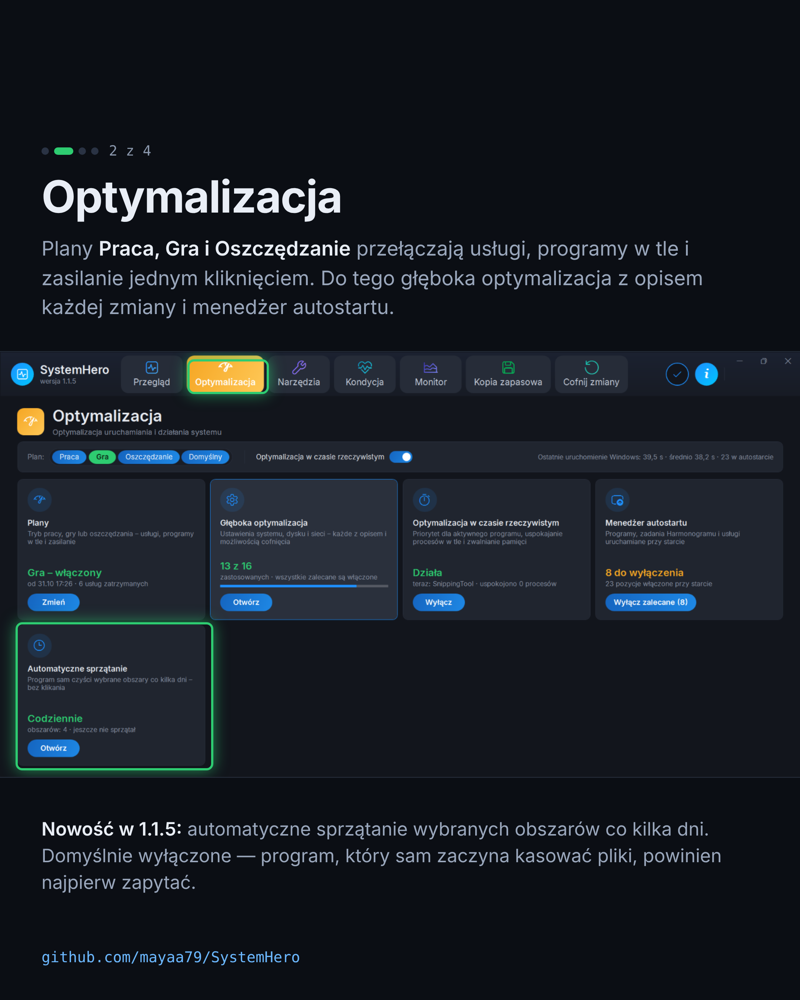
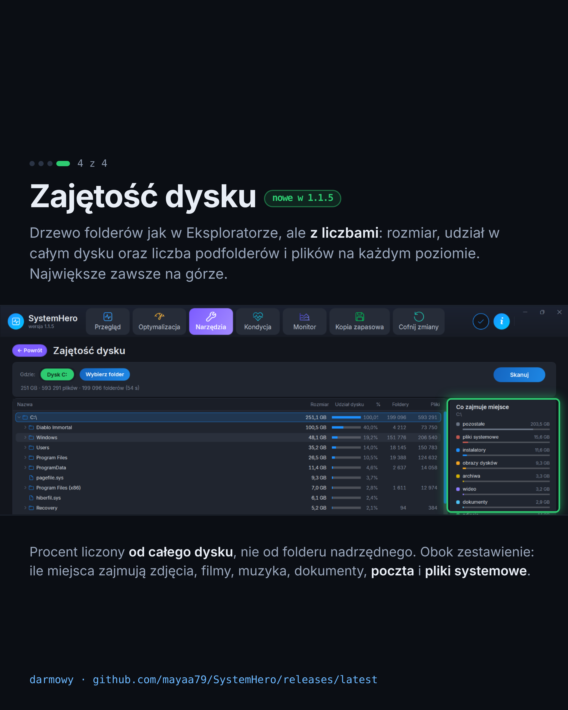
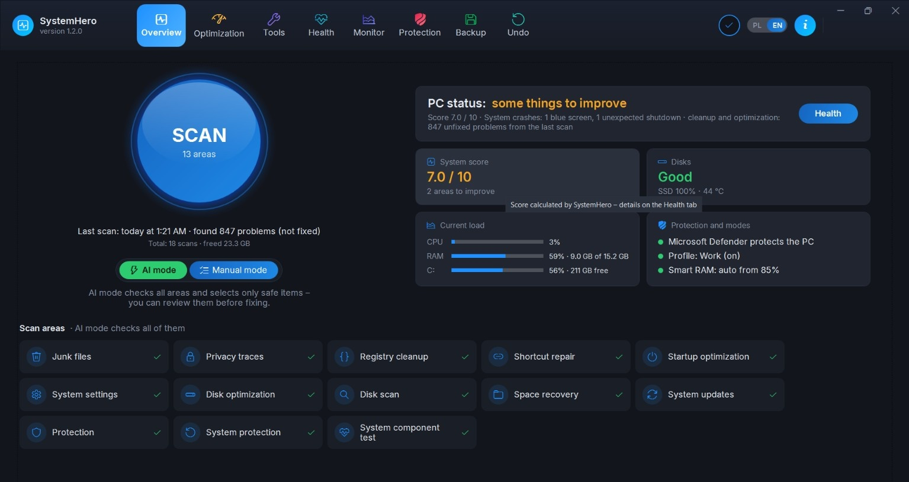
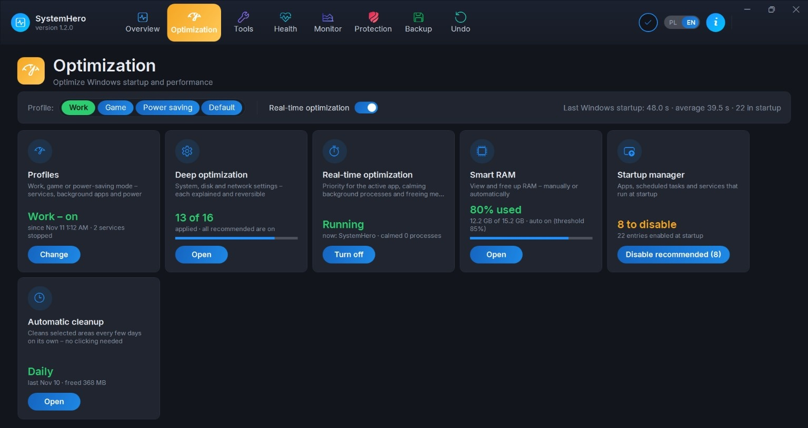
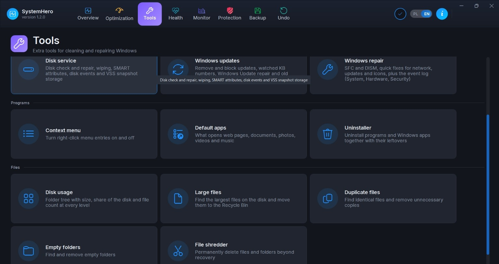
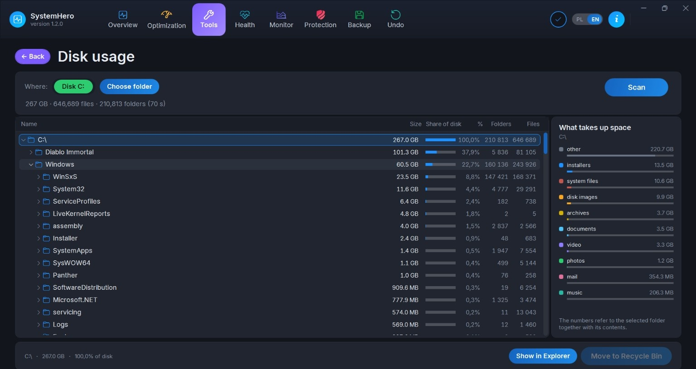
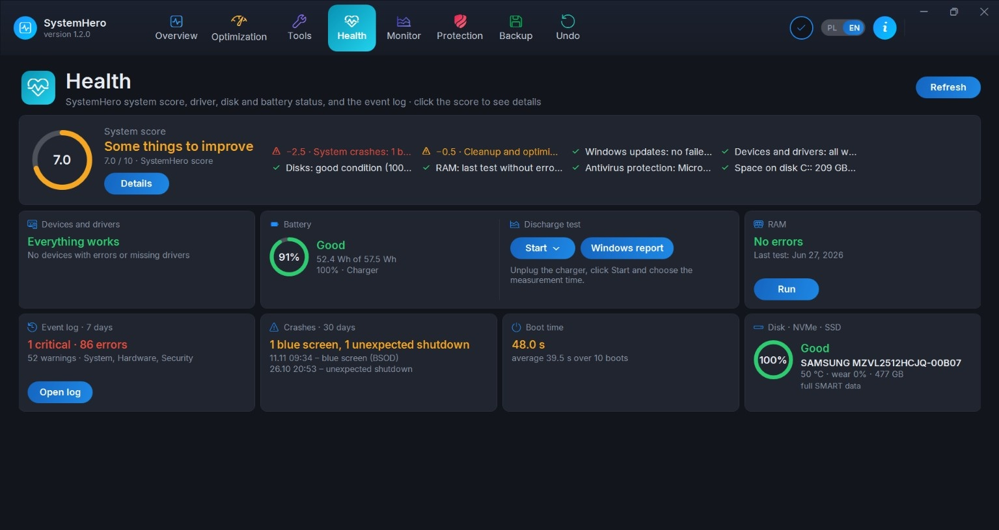
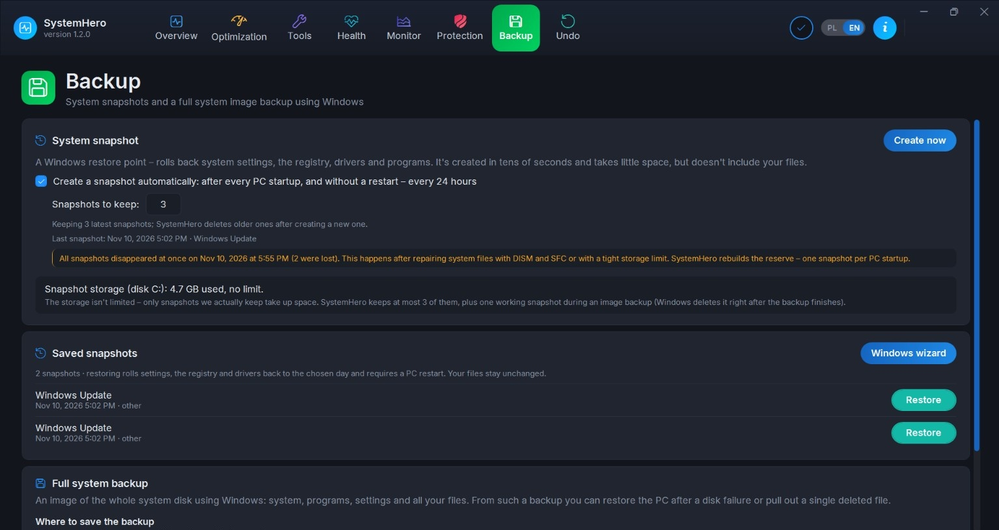

# SystemHero

**Darmowy program do czyszczenia, przyspieszania i naprawy Windows. Bez reklam, bez zakładania konta, a każdą zmianę da się cofnąć.**

### [⬇️ Pobierz SystemHero](https://github.com/mayaa79/SystemHero/releases/latest)

Pobierz plik `SystemHero-Setup-<wersja>.exe` i uruchom go. Instalator zawiera wszystko, czego program potrzebuje, łącznie ze środowiskiem .NET.

## Co potrafi

**Jedno kliknięcie, 13 obszarów.** Przycisk *SKANUJ* sprawdza niepotrzebne pliki, ślady prywatności, rejestr, skróty, autostart, ustawienia systemu, dyski, odzyskiwanie miejsca, aktualizacje, ochronę, punkty przywracania i stan plików systemowych. W *Trybie AI* zaznacza tylko bezpieczne pozycje, a przed naprawą możesz wszystko przejrzeć.

**Przyspieszanie**
- Menedżer autostartu: programy, zadania i usługi uruchamiane razem z Windows.
- Plany *Praca / Gra / Oszczędzanie*: tymczasowo wyłączają zbędne usługi i programy w tle.
- Głęboka optymalizacja: ponad tuzin sprawdzonych ustawień systemu dobranych do Twojej wersji Windows, każde da się cofnąć osobno.
- Optymalizacja w czasie rzeczywistym i **Smart RAM**, który zwalnia pamięć ręcznie albo automatycznie.

**Narzędzia w czterech grupach**
- *Ochrona i sieć:* Microsoft Defender, automatyczne łączenie z najsilniejszą siecią Wi-Fi, test prędkości internetu (Cloudflare lub LibreSpeed).
- *System i sprzęt:* serwis dysku z atrybutami SMART, aktualizacje Windows (także usuwanie i blokowanie wybranych poprawek), naprawa Windows przez DISM i SFC, dziennik zdarzeń z podpowiedziami.
- *Programy:* deinstalator z usuwaniem pozostałości, porządki w menu kontekstowym, programy domyślne.
- *Pliki:* zajętość dysku, duże pliki, duplikaty, puste foldery, niszczarka plików.

**Kondycja i monitor.** Ocena komputera w skali 0–10 z podpowiedziami, co poprawić, stan dysków (SMART, temperatura, zużycie SSD) i baterii, awarie systemu, a do tego podgląd CPU, RAM, dysku i sieci na żywo.

**Bezpieczeństwo zmian.** Zanim program zmieni rejestr albo ustawienia, zapisuje kopię zapasową, a w każdej chwili możesz też utworzyć punkt przywracania systemu. Z zakładki *Cofnij zmiany* wszystko przywrócisz jednym kliknięciem. Program korzysta wyłącznie z mechanizmów wbudowanych w Windows: nie instaluje własnych sterowników ani usług.

Więcej zrzutów ekranu

## Język

Interfejs jest po polsku i po angielsku. Przy pierwszym uruchomieniu język wybiera się według języka Windows, a potem można go w każdej chwili przełączyć suwakiem **PL | EN** w nagłówku okna.

## Wymagania

- Windows 10 (od wersji 1607) albo Windows 11, 64-bit
- Uprawnienia administratora (program prosi o nie przy starcie)

## Aktualizacje

Program sam sprawdza, czy jest nowa wersja, i pokazuje listę zmian. Aktualizacja to po prostu instalacja nowszej wersji, a ustawienia zostają. Historia wersji: [Releases](https://github.com/mayaa79/SystemHero/releases).

## Uwaga: ostrzeżenie Windows SmartScreen

Instalator nie jest jeszcze podpisany certyfikatem, dlatego przy pierwszym uruchomieniu Windows może pokazać okno „System Windows ochronił ten komputer”. Kliknij **Więcej informacji → Uruchom mimo to**.

## Masz uwagi?

Błędy i pomysły zgłaszaj w zakładce [Issues](https://github.com/mayaa79/SystemHero/issues) albo mailowo (adres poniżej). Jeśli program Ci się przydał, zostaw ⭐: dzięki temu łatwiej go znaleźć innym.

## Autor i kontakt

Autor: **Marcin Majewski** · e-mail: [mmajewski.mmm@gmail.com](mailto:mmajewski.mmm@gmail.com)  
Adres: ul. Poprzeczna 7b/6, 75-841 Koszalin, Polska

## Licencja

SystemHero jest darmowy (freeware) do użytku prywatnego i firmowego. Szczegóły: [LICENSE.md](LICENSE.md).

---

### English

**SystemHero** is a free Windows 10/11 utility for cleaning, speeding up and repairing your PC. No ads, no account, and every change is backed up and can be undone.

### [Download the latest installer](https://github.com/mayaa79/SystemHero/releases/latest)

Download `SystemHero-Setup-<version>.exe` and run it. The installer contains everything the program needs, including the .NET runtime.

**What it does**
- One-click scan of 13 areas: junk files, privacy traces, registry, shortcuts, startup, system settings, disks, reclaimable space, updates, protection, restore points and system file health. AI mode selects only safe items, and you can review everything before fixing.
- Speed-up: startup manager, Work / Game / Power-saving profiles, deep optimization with over a dozen reversible tweaks, real-time optimization and Smart RAM.
- Tools: Microsoft Defender settings, best Wi-Fi auto-switch, internet speed test (Cloudflare or LibreSpeed), disk service with SMART attributes, Windows Update management, Windows repair (DISM/SFC), event log with hints, uninstaller with leftovers removal, context menu and default apps, disk usage tree, large and duplicate file finders, empty folders and a file shredder.
- Health and monitor: PC score 0-10 with tips, disk and battery health, crash history and live CPU / RAM / disk / network view.
- Safety: registry and settings are backed up before every change and can be restored from the Undo tab. Only mechanisms built into Windows are used, with no own drivers or services.

More screenshots

**Language.** The interface is available in English and Polish. It follows your Windows language on first start and can be switched at any time with the **PL | EN** switch in the window header.

**Requirements.** Windows 10 (version 1607 or later) or Windows 11, 64-bit. Administrator rights are requested at startup.

**Updates.** The program checks for new versions and shows what changed. Updating is just installing a newer version, and your settings are kept.

**SmartScreen note.** The installer is not code-signed yet, so Windows may show "Windows protected your PC" on first launch. Click **More info > Run anyway**.

**Contact.** Author: Marcin Majewski, ul. Poprzeczna 7b/6, 75-841 Koszalin, Poland, e-mail: [mmajewski.mmm@gmail.com](mailto:mmajewski.mmm@gmail.com). Bugs and ideas: [Issues](https://github.com/mayaa79/SystemHero/issues).

Freeware for private and business use, see [LICENSE-en.md](LICENSE-en.md) (English) or [LICENSE.md](LICENSE.md) (Polish).
